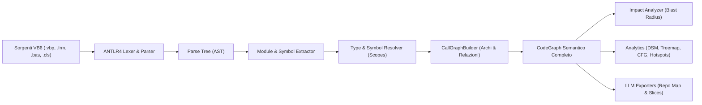

# VB6 Analyzer — Parser & Motore di Analisi Semantica

Questo modulo contiene il motore centrale di parsing, estrazione semantica, risoluzione dei simboli e calcolo delle metriche architetturali per **Macondo (VB6 Analyzer)**.

> ⚠️ **REQUISITO MULTI-LINGUA (i18n) PER SVILUPPATORI ED LLM:**  
> Tutti i testi, messaggi, report o etichette destinate all'interfaccia utente o all'utente finale devono essere integrati nel sistema di localizzazione centralizzato (`LocalizationService` in `VB6Analyzer.App`), garantendo sempre sia la traduzione in **Italiano** che in **Inglese**.

---

## 🧩 Moduli e Architettura del Core Engine

```
VB6ParserSpike/src/
├── VB6Analyzer.Parser/               # Parser sintattico basato su ANTLR4
│   ├── Grammar/
│   │   ├── VisualBasic6Lexer.g4      # Grammatica lessicale ufficiale VB6
│   │   ├── VisualBasic6Parser.g4     # Grammatica sintattica completa (istruzioni, blocchi With, dichiarazioni)
│   │   └── ORIGIN.md                 # Provenienza (ProLeap / antlr/grammars-v4) e licenza MIT
│   └── external/
│       └── antlr4-4.13.2-complete.jar# Jar di generazione ANTLR4
│
├── VB6Analyzer.Semantic/             # Motore di Analisi Semantica e Grafo
│   ├── Model/                        # Entità del Grafo: CodeGraph, Symbol, Relationship, ParameterSymbol
│   ├── Extraction/                   # SymbolExtractor & ModuleExtractor (estrazione AST -> Symbol)
│   ├── Resolution/                   # SymbolResolver & TypeResolver (risoluzione scope e chiamate)
│   ├── Graph/                        # CallGraphBuilder (costruzione archi CALLS, INSTANTIATES, CONTAINS)
│   ├── Impact/                       # ImpactAnalyzer (calcolo Blast Radius, catene di chiamate e rischio)
│   ├── Analytics/                    # Motori di calcolo metriche specializzate:
│   │   ├── ControlFlow/              # Control Flow Graph (CFG) e Complessità Ciclomatica
│   │   ├── Dsm/                      # Matrice di dipendenza DSM (Design Structure Matrix)
│   │   ├── Hotspots/                 # Calcolo Hotspot di rischio (CC vs Churn/Fan-In)
│   │   ├── ScreenFlow/               # Mappatura del flusso di navigazione schermate UI (Form)
│   │   └── Treemap/                  # Calcolo gerarchico Treemap LOC e complessità
│   └── Export/                       # Esportatori:
│       ├── CodeGraphMarkdownExporter # Repo Map Markdown e Context Slice per prompt AI / LLM
│       └── CodeGraphJsonExporter     # Serializzazione completa del grafo in JSON
│
├── VB6Analyzer.Parser.Spike/         # Console app per il collaudo e debug del Parser sintattico
└── VB6Analyzer.Semantic.Spike/       # Console app per il collaudo del Grafo e della Risoluzione
```

---

## 🔍 Pipeline di Analisi Semantica

Il processo di analisi attraversa le seguenti fasi coordinate:



### 1. Parsing Sintattico (`VB6Analyzer.Parser`)
- Compilazione della grammatica ANTLR4 in C# tramite `Antlr4BuildTasks`.
- Gestione della sintassi complessa di VB6: blocchi `With`, chiamate qualificate/non qualificate, proprietà con accessor multipli (`Get`, `Let`, `Set`), istanziazioni `Set ... = New ...`, dichiarazioni API `Declare`, istruzioni `On Error Goto`, ecc.

### 2. Estrazione dei Simboli (`Extraction/`)
- `ModuleExtractor`: identifica il tipo di modulo (`Form`, `Module`, `Class`, `UserControl`).
- `SymbolExtractor`: estrae gerarchicamente le definizioni (Sub, Function, Property, Field, Constant, Enum, UserDefinedType, Parameter).

### 3. Risoluzione dei Simboli e Tipi (`Resolution/`)
- Risoluzione gerarchica a livelli di visibilità:
  - `LocalScope`: variabili locali e parametri.
  - `ContainerScope`: membri privati del modulo o della classe.
  - `GlobalScope` / `ProjectScope`: membri pubblici e moduli `.bas` globali.
  - `WorkspaceScope`: simboli condivisi cross-project nei gruppi di progetti (`.vbg`).
- Risoluzione avanzata di `With ... End With` e `Me`.

### 4. Costruzione del Grafo delle Chiamate (`Graph/`)
- Creazione delle relazioni (`CALLS`, `INSTANTIATES`, `CONTAINS`, `USES_TYPE`, `HANDLES_EVENT`).
- Attribuzione di un livello di confidenza di risoluzione (`Exact`, `Probable`, `Unresolved`).

### 5. Calcolo del Blast Radius e Rischio di Regressione (`Impact/`)
- `ImpactAnalyzer`: attraversa ricorsivamente la rete dei chiamanti per determinare:
  - **Chiamanti Diretti** e **Chiamanti Indiretti**.
  - **Profondità Massima (Max Depth)** della catena di dipendenze.
  - **Form UI Impattate** e **Classi/Moduli toccati**.
  - **Livello di Rischio**: `Low`, `Medium`, `High`, `Critical`.

### 6. Esportazione per LLM & AI (`Export/`)
- **Repo Map Markdown**: sommario ad alta densità informativa e basso consumo di token, ideale come contesto globale di progetto per LLM.
- **LLM Context Slice**: estrazione del subgrafo semantico isolato centrato su una specifica routine con tutte le sue dipendenze dirette, chiamanti e contesto di appartenenza.

---

## 🧪 Esecuzione dei Test e Fixture di Collaudo

### Prerequisiti
- **.NET 8 SDK**
- **Java 11+** (richiesto esclusivamente in fase di build da `Antlr4BuildTasks`)

### Collaudo del Parser (Spike Sintattico)
```bash
cd src/VB6Analyzer.Parser.Spike
dotnet run
```
Verifica la correttezza del parsing sui file fixture (`Fixtures/*.cls`):
- `00_HelloWorld.cls`: verifica di base.
- `01_QualifiedMemberCall.cls`: chiamate qualificate (`Customer.Update`).
- `02_WithImplicitCall.cls`: chiamate implicite dentro blocchi `With`.
- `03_UnqualifiedCallAndCall.cls`: chiamate di procedura non qualificate.
- `04_SetNewInstantiation.cls`: istanziazioni `Set` / `New`.
- `05_LateBindingCreateObject.cls`: chiamate late binding con `CreateObject`.

### Collaudo dell'Analisi Semantica (Spike Semantico)
```bash
cd src/VB6Analyzer.Semantic.Spike
dotnet run
```
Verifica l'estrazione gerarchica dei simboli, l'unificazione delle Property `Get`/`Let`, i container `CONTAINS` e l'aggregazione di più moduli in un unico `CodeGraph`.
